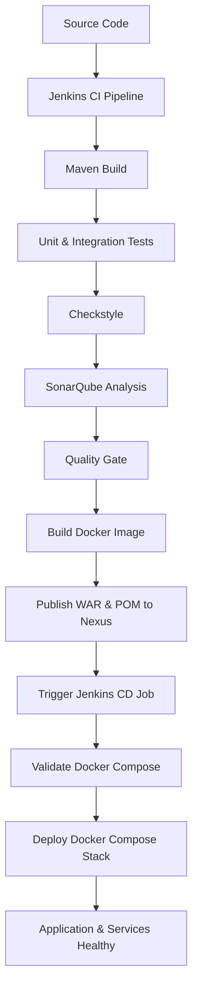

# VProfile – DevOps CI/CD Project

A hands-on DevOps project demonstrating the progressive containerization, automation, and deployment of the VProfile Java web application using Docker, Jenkins, Docker Compose, SonarQube, and Nexus Repository Manager.

## Project Background & Source Code

This project is based on the original VProfile Java web application. The application source code was obtained from:

**Original Repository:** [hkhcoder/vprofile-project](https://github.com/hkhcoder/vprofile-project)

The original repository provides the application source code and its initial project structure. The DevOps implementation documented here was developed separately, extending the application with containerization, CI/CD automation, code quality analysis, artifact management, and automated deployment.

## Project Journey

The project was implemented progressively, with each phase building on the previous one:

1. **Docker Containerization** – Built a Docker image for the Java web application and ran it as a container.
2. **Jenkins CI Pipeline** – Set up Jenkins and automated the application build, testing, and validation process.
3. **Code Quality & Artifact Management** – Integrated Checkstyle, SonarQube, and Nexus Repository Manager into the CI pipeline.
4. **Docker Compose** – Migrated the application and its supporting services to a multi-container Docker Compose environment.
5. **Jenkins CD Pipeline** – Created a separate Jenkins job to validate and deploy the Docker Compose stack.
6. **Integrated CI/CD** – Connected the CI and CD jobs so a successful CI execution automatically triggers the CD job and waits for its result.

## CI/CD Workflow



## Technologies & Tools

| Category | Technologies |
|---|---|
| Application | Java, Spring MVC, Spring Security, Spring Data JPA, JSP |
| Build | Maven |
| Application Server | Apache Tomcat |
| Containerization | Docker |
| Container Orchestration | Docker Compose |
| CI/CD | Jenkins |
| Code Quality | Checkstyle, SonarQube |
| Artifact Repository | Nexus Repository Manager |
| Database | MySQL |
| Supporting Services | Memcached, RabbitMQ, Elasticsearch |
| Version Control | Git, GitHub |
| Operating Environment | Linux |

## Implementation Details

### Phase 1 – Docker Containerization

- Created a Dockerfile to package the Java web application.
- Used Apache Tomcat 10.1 with JDK 17 as the application runtime.
- Built the application WAR file and copied it into the Tomcat ROOT deployment directory.
- Built and ran the application as a Docker container.

### Phase 2 – Jenkins Setup & CI Pipeline

- Set up Jenkins using a JDK 21-based Jenkins environment.
- Configured the required JDK and Maven tools.
- Created a Jenkins Pipeline to automate the application build and validation process.
- Implemented the following pipeline stages:
  - Maven build.
  - Unit testing.
  - Integration testing.
  - Checkstyle analysis.
  - SonarQube code analysis and Quality Gate validation.
  - Docker image build.
  - Publishing the WAR artifact and POM file to Nexus Repository Manager.

### Phase 3 – Docker Compose Environment

Moved the application and its supporting services into a Docker Compose deployment.

The environment includes:

| Container | Image / Service |
|---|---|
| app | VProfile application |
| db01 | MySQL 8.0 |
| mc01 | Memcached 1.6 |
| rmq01 | RabbitMQ 3 Management |
| es01 | Elasticsearch 7.10.2 |

- Defined the services, network, environment variables, and dependencies in the Compose file.
- Added health checks for the application dependencies.
- Configured the application to start after its required services become healthy.
- Used an environment file for deployment configuration.

### Phase 4 – Jenkins CD Pipeline

Created a separate Jenkins job (`vprofile-compose-cd`) to handle deployment using Docker Compose.

The CD pipeline includes:

- Workspace and Compose file validation.
- Docker and Docker Compose availability checks.
- Verification that the requested application image exists.
- Docker Compose configuration validation.
- Deployment of the application stack using `docker compose up -d --wait`.

The deployment configuration is provided through a Jenkins-managed environment file credential.

### Phase 5 – Integrated CI/CD

Integrated the CI and CD pipelines:

- The CI pipeline builds and validates the application.
- After successful CI execution, Jenkins triggers the separate CD job.
- The application image build number is passed to the CD job as a parameter.
- The CI pipeline waits for the downstream CD job to finish.
- The overall pipeline execution reflects the downstream deployment result.

This provides an automated flow from application build and validation to deployment, without requiring a separate manual deployment trigger after a successful CI run.

## Deployment Verification

The integrated pipeline was successfully executed and verified:

- Jenkins CI build completed successfully.
- SonarQube Quality Gate passed.
- Docker image was built successfully.
- WAR and POM artifacts were published to Nexus.
- Jenkins triggered the CD job and waited for completion.
- Docker Compose deployed the application and supporting services.
- The application and its dependencies reached a healthy state.

Application HTTP response verification:

```bash
curl -sS -o /dev/null -w 'HTTP Status: %{http_code}\n' http://localhost:8084/
```

Expected result:

```text
HTTP Status: 200
```

## Repository Structure

```text
vprofile-project/
├── compose/
│   └── docker-compose.yml
├── jenkins-image/
├── src/
├── Dockerfile
├── Jenkinsfile
├── Jenkinsfile.compose
├── pom.xml
└── README.md
```

Additional local configuration and backup files may exist in the development environment but are not required as part of the documented project structure.

## Configuration & Security

- Runtime configuration is supplied through environment variables.
- Sensitive values are kept outside source control.
- Jenkins credentials are used for Nexus authentication and Compose deployment configuration.
- The `.env.example` file provides a template for required environment variables.
- Replace example credentials and environment-specific settings before running the stack in another environment.

## Future Enhancements

Potential next steps for extending the project:

- Configure a GitHub Webhook to trigger the CI pipeline automatically on source code changes.
- Add automated post-deployment smoke tests.
- Extend the deployment workflow to Kubernetes.
- Introduce infrastructure automation and configuration management.
